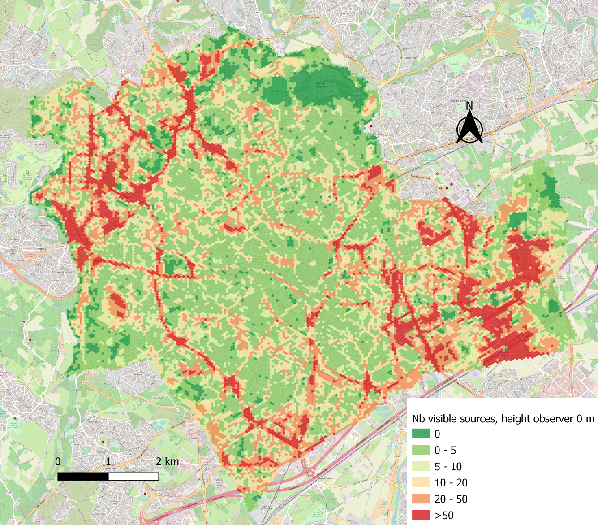
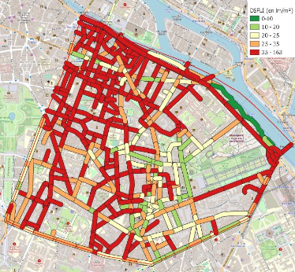

[[English](https://github.com/MathieuChailloux/LightPollutionToolbox/blob/master/README.md) | [Français](https://github.com/MathieuChailloux/LightPollutionToolbox/blob/master/README_fr.md)]

# Table of contents
- [Description](#description)
- [Documentation](#documentation)
- [Light Pollution indicators](#light-pollution-indicators)
- [Light Flux Surfacic Density](#light-flux-surfacic-density)
- [Credits](#credits)
- [Installation](#installation)
- [Developers](#developers)

# Description

*LightPollutionToolbox* is a QGIS plugin that gathers various geoprocessing tools to characterize and map light pollution.

A dedicated graphical interface allows you to compute **light pollution indicators** from satellite images:
 - contribution to skyglow
 - blue light emission
 - visibility of light sources

A processing chain has been developed to compute the **Light Flux Surface Density** (DSFLI) indicator.

This tool is intended to evolve and be extended with any relevant geoprocessing related to light pollution and dark corridors (Trame noire).

# Documentation

Available documentation:
 - [Video tutorials on Light Flux Surface Density](https://www.youtube.com/playlist?list=PLh9oFe6PuPCVSnbwOEN6aZ1hHkdg5qzg7)
 - [Video tutorials on Light Pollution Indicators](https://www.youtube.com/playlist?list=PLh9oFe6PuPCU_K-qqZBIKJWEuRJFRa4Gc)
 - [Methodological note on Light Flux Surface Density](https://github.com/MathieuChailloux/LightPollutionToolbox/blob/master/docs/fr/NoteDSFLI_INRAE.pdf)
 - [Methodological note on light pollution indicators](https://github.com/MathieuChailloux/LightPollutionToolbox/blob/master/docs/fr/NoteIndicateursPOLLUM_INRAE_fr.pdf)

# Light Pollution Indicators

The algorithms are available in the Processing toolbox or via the *LightPollutionToolbox* button in the menu.
The 3 main indicators are the following:
- *Contribution to skyglow (Radiance)*
- *Emission in the blue part of the spectrum*
- *Visibility of light sources*: this processing is divided into 3 sub-processes:
	- 1: *DSM computation* (Digital Surface Model) using the DTM, buildings and, optionally, vegetation
	- 2: *Viewshed computation*; part of the code comes from the Viewshed analysis plugin: https://www.zoran-cuckovic.from.hr/QGIS-visibility-analysis
	- 3: *Average number of light sources per grid cell*

There are also 2 other processing tools in the *Utils Light Pollution Indicators* submenu of the toolbox:
- *create MNT from RGE Alti*: creates a DTM from an extent area, the tiles and the ASC DTM folder of RGE Alti
- *Pretreatments to remove dark zones*: sets to 0 the pixels below the median of the pixels for each band

# Light Flux Surface Density

The 2 main algorithms are:
 - *Classify lighting layer*: checks the compliance of a public lighting layer with certain regulatory indicators (ULR, luminous flux, color temperature)
 - *Light Flux Surfacic Density (from raw data)*: computation of the Light Flux Surface Density (DSFLI) from raw data

The *Statistics* group is intended to gather processing tools that compute statistics, such as the *Radiance Zonal Statistics* algorithm, which computes radiance per surface area and per inhabitant from a satellite image (for example NASA's [Black Marble](https://blackmarble.gsfc.nasa.gov/#product)) and a territorial division (for example a layer of municipalities).

The *Light Flux Surfacic Density* group gathers the intermediate processing tools used to compute the DSFLI:
 - *Add cadastre selection*: adds a manual selection of cadastral parcels to a surface layer
 - *Apply symbology to DSFL layer*: applies a predefined legend based on the regulatory thresholds to a DSFLI layer
 - *Light Flux surfacic density*: computes the DSFLI from a public lighting layer, a reporting layer and a surface layer
 - *Light Flux surfacic density (from surface)*: computes the DSFLI from a public lighting layer and a surface layer
 - *Reporting per roads*: builds a reporting layer by applying buffers around roads
 - *Roads Extent (BDTOPO + Cadastre)*: builds a surface layer from a BDTOPO road layer and a cadastral parcel layer
 - *Roads Extent (BDTOPO)*: builds a surface layer from a BDTOPO road layer
 - *Roads Extent (Cadastre)*: builds a surface layer from a cadastral parcel layer

A detailed description of the parameters is available in each algorithm.

# Credits

*LightPollutionToolbox* was developed by Mathieu Chailloux and Antoine Sensier ([*UMR TETIS*](https://www.umr-tetis.fr) / [*INRAE*](http://www.inrae.fr)) for the [*Centre de ressources Trame verte et bleue*](http://www.trameverteetbleue.fr/).

*Development*: Mathieu Chailloux (mathieu@chailloux.org) & Antoine Sensier

*Coordination*: Jennifer Amsallem

> Chailloux, M. & Amsallem, J. (2021) LightPollutionToolbox : a QGIS plugin to characterize light pollution

# Installation

To install *LightPollutionToolbox* in *QGIS*, go to the menu *Plugins->Manage and Install Plugins->All*, search for *LightPollutionToolbox* and click *Install*.

A light bulb icon should then appear in the toolbar, and the algorithms will appear in the Processing toolbox.

# Developers

The code is organized into subfolders, except for a few root files:
 - LightPollutionToolbox.py is the main entry point of the plugin
 - build.py is used to package a new version
 - metadata.txt contains plugin QGIS metadata

The subfolders are organized as follows:
 - **algs** contains processing tools used by LightPollutionToolbox
   - *DSFLI* contains python files processing light flux surface density
   - *modules* contains python files processing light pollution indicators 
 - **assets** for some configuration files that must be embedded
 - **docs** contains user guides
 - **help** for help texts within the tool
 - **i18n** contains translation files
 - **qgis_lib** gathers Python files defining the interactions with QGIS (PyQGIS / PyQt libraries in particular)
 - **sample_data** contains sample data
 - **ui**  Python files managing GUI (Graphical User Interface)

To clone the git repository:
> git clone https://github.com/MathieuChailloux/LightPollutionToolbox.git
